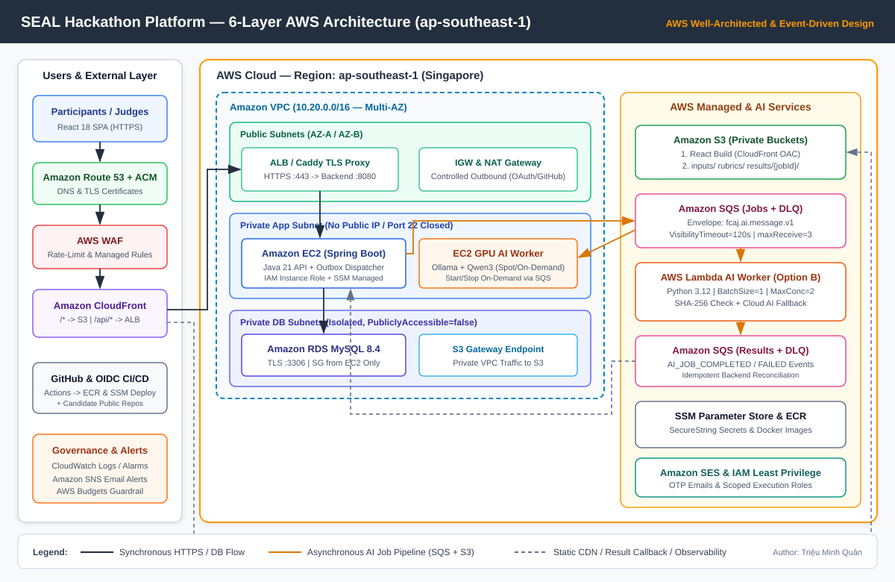

# SEAL Hackathon Platform — Modernizing a Hackathon Management & Evaluation Platform on AWS with an Asynchronous AI Judge Assistant

---

## 1. Executive Summary

University and community hackathons (such as the **SEAL / FCAJ Hackathon System**) often face severe judging bottlenecks when panels must manually review dozens or hundreds of GitHub repositories within tight deadlines. Verifying layered architecture, spotting hardcoded credentials, reviewing unit test coverage, and scoring strictly against rubrics is time-consuming and prone to inconsistency.

This proposal defines the cloud architecture and modernization roadmap for the **SEAL Hackathon Platform** on **AWS (`ap-southeast-1` — Singapore)** following a **6-layer architecture (Edge, Network, Application & Data, Async AI Services, Observability & Governance, CI/CD)**. Its centerpiece is the **Asynchronous AI Judge Worker** built with **Amazon S3**, **Amazon SQS (+ DLQs)**, **AWS EC2 GPU (Qwen3 Local LLM)** or **AWS Lambda (Cloud AI Fallback)**. The system evaluates candidate code at an immutable Git commit SHA, extracts line-level evidence, and returns safe advisory feedback within 15–30 seconds per job.

---

## 2. Problem Statement, Objectives & Scope

### 2.1. Current Challenges
1. **Slow & Inconsistent Manual Grading:** Judges spend excessive effort cloning repos, checking config hygiene, locating tests, and aligning scores across rubrics.
2. **Timeout & Security Risks of Synchronous AI Calls:**
   - Calling an LLM synchronously inside a Spring Boot HTTP request causes `504 Gateway Timeout` errors because repository analysis takes 15–50 seconds.
   - Sending raw repositories to external endpoints without sanitization risks credential leakage and prompt injection.
3. **High Cost of Always-On GPU Compute:** Running an AWS EC2 GPU instance (`g4dn.xlarge` / `g5.xlarge`) 24/7 costs `$380 – $720/month`, far exceeding a student/PoC budget (`<$20/month`).

### 2.2. Objectives
- **Decouple Web API from AI Inference:** The API immediately responds with `HTTP 202 Accepted` and enqueues jobs into **Amazon SQS** for asynchronous execution.
- **Security & AWS Best Practices:** Store all artifacts (`inputs/`, `rubrics/`, `results/`) in private **Amazon S3** buckets, enforce **IAM Least Privilege**, and eliminate hardcoded secrets.
- **Evidence-Based, Safe AI Output:** Strictly enforce JSON contract compliance (`fcaj.ai.output.v1`), redact secrets (`***REDACTED***`), block prompt injection, and compute weighted averages deterministically in Python.
- **Keep PoC Operating Costs Below $20/month (~500,000 VND/month).**

### 2.3. Scope
- **In Scope:** Core Hackathon Web/API stack (`React 18` + `Spring Boot 21` + `RDS MySQL 8.4`), the **Asynchronous AI Judge Pipeline** (`S3` + `SQS` + `DLQ` + `EC2 Ollama Qwen3` / `AWS Lambda`), **CloudWatch / SNS / AWS Budgets** monitoring, and **GitHub Actions OIDC -> ECR** deployment.
- **Out of Scope:** The AI acts strictly as a **Technical Advisor** providing evidence-backed suggestions; **human judges remain the sole authority for official scores**. Candidate repository scripts are never executed to eliminate Remote Code Execution (RCE) risk.

---

## 3. Solution Architecture & AWS Service Selection

{}
💡 **Diagram Note:** The diagram above illustrates the full 6-layer architecture in `ap-southeast-1`. You can also export and swap in your own `.drawio` PNG image at `static/images/2-Proposal/seal-aws-architecture.svg` (or `.png`) if needed.
{}

### AWS Service Selection Rationale

| Layer | AWS Services | Role in Architecture | Selection Rationale |
| :--- | :--- | :--- | :--- |
| **1. Edge & Security** | **Route 53, AWS WAF, CloudFront, ACM** | DNS routing, rate-limit & managed firewall rules, CDN serving React SPA (`/*`) and proxying `/api/*` to ALB. | Protects auth endpoints against brute force/crawlers; single-domain routing keeps `HttpOnly + SameSite=Lax` cookies and CSRF tokens reliable. |
| **2. Network** | **Amazon VPC (2 AZs), IGW, NAT, ALB, S3 Gateway Endpoint** | Isolates backend and database inside private subnets while keeping S3 traffic internal via Gateway Endpoint. | Satisfies **Security Pillar**: SSH port 22 stays closed, RDS is `PubliclyAccessible=false`, and S3 Gateway Endpoint avoids NAT data charges (`$0`). |
| **3. App & Data** | **EC2 (Spring Boot), RDS MySQL 8.4, Amazon S3** | Core hackathon business logic, ACID relational storage, and immutable storage for source snapshots & AI JSON results. | Managed RDS handles backups/patching; private S3 buckets (with CloudFront OAC) offer 11-nines durability. |
| **4. Async AI Worker** | **Amazon SQS (+ 2 DLQs), EC2 GPU (Qwen3) / AWS Lambda (Python 3.12)** | Buffers `Jobs` and `Results` queues; runs decoupled code evaluation; isolates poison messages into DLQs. | **Cost & Reliability**: SQS lets the GPU EC2 stay `Stopped` between judging windows without dropping jobs, while Lambda offers zero-idle serverless execution. |
| **5. Security & Governance** | **IAM, SSM Parameter Store, CloudWatch, SNS, AWS Budgets** | Least-privilege execution roles, encrypted `SecureString` secrets, centralized logs/alarms, and spend alerts. | Zero hardcoded credentials; **Systems Manager Session Manager** enables audited administration with port 22 closed. |
| **6. CI/CD** | **GitHub Actions OIDC, Amazon ECR** | Builds immutable Docker images tagged by commit SHA and deploys via SSM Run Command. | OIDC federation removes long-lived IAM keys from GitHub Secrets. |

---

## 4. Implementation Plan & 12-Week Timeline

| Phase | Timeline | Focus Areas | Deliverables |
| :--- | :---: | :--- | :--- |
| **Phase 1: AWS Foundations** | Weeks 1 – 4 *(14/09 – 09/10/2026)* | FCAJ onboarding; hands-on mastery of IAM, VPC, EC2, S3, RDS, CloudFront, SQS, Lambda, and CloudWatch. | Hardened AWS sandbox account, AWS Budgets alerts, completed core AWS labs. |
| **Phase 2: Architecture & Contracts** | Weeks 5 – 6 *(12/10 – 23/10/2026)* | SEAL Hackathon requirements analysis, 6-layer architecture design, `fcaj.ai.message.v1` & Output Schema definition. | Architecture proposal, Pricing Calculator estimate, JSON input/output contracts. |
| **Phase 3: AI Worker & Benchmarking** | Weeks 7 – 9 *(26/10 – 13/11/2026)* | Built `code_cleaner.py`, `ai_grader.py`, `sqs_worker.py`, `lambda_handler.py`; benchmarked Qwen3 on EC2 `ap-southeast-1`. | AI Worker passing 13/13 unit tests, live EC2 benchmark & `q8_0` KV-cache tuning report. |
| **Phase 4: Integration, Monitoring & Workshop** | Weeks 10 – 12 *(16/11 – 04/12/2026)* | CloudWatch Logs/Alarms, SNS alerts, E2E validation, AWS Study Group blogs, bilingual Workshop & resource clean-up. | Live bilingual Hugo website on GitHub Pages, Live Demo, `$0.00` verified clean-up. |

---

## 5. Cost Estimation & Optimization (AWS Pricing Calculator)

Estimated monthly cost in **`ap-southeast-1` (Singapore)** for **1 hackathon round/month (50 teams, 200 AI grading jobs/month)** leveraging **SQS On-Demand EC2 Start/Stop** and AWS Free Tier:

| AWS Service | Configuration & Monthly Usage | Est. Monthly Cost | Optimization Strategy |
| :--- | :--- | :---: | :--- |
| **Amazon S3** | `1 GB` storage (`inputs/`, `rubrics/`, `results/`, SPA), `5,000 PUT/GET` | **$0.03** | Covered by Free Tier (5 GB) + S3 Lifecycle rule expiring temporary snapshots after 30 days. |
| **Amazon SQS** | `4` queues (`Jobs`, `Jobs-DLQ`, `Results`, `Results-DLQ`), `< 10,000 requests` | **$0.00** | Always Free Tier includes 1,000,000 requests/month. |
| **AWS Lambda (Option B)** | `200 invocations/mo`, `512 MB RAM`, avg `20s/job` (`2,000 GB-s`) | **$0.00** | Well within Always Free Tier (400,000 GB-seconds/month). |
| **EC2 AI Worker (`g4dn.xlarge` Spot — Option A)** | Active only during judging windows: **`20 hrs/mo`** (`~$0.18/hr` Spot) + `30 GB gp3` | **$6.00** | Saves **98.4%** vs. 24/7 On-Demand (`$380/mo`) since SQS buffers jobs while EC2 is stopped. |
| **EC2 Backend (`t3.small` / `t4g.small`)** | Demo-window schedule (`100 hrs/mo`) or `730 hrs/mo` | **$2.10 – $15.00** | Eligible for Free Tier (`t3.micro`/`m7i-flex.large`) during the first 12 months (`$0.00`). |
| **Amazon RDS MySQL (`db.t4g.micro`)** | Single-AZ PoC (`20 GB gp3`) | **$0.00 – $12.41** | Covered by AWS Free Tier (750 hrs/mo for 12 months -> `$0.00`). |
| **SSM Parameter Store & CloudWatch** | Standard Parameters (`$0`), Logs `< 5 GB/mo`, `2 Alarms` | **$0.20** | Set log retention to 7–14 days to prevent unbounded log storage costs. |
| **Cloud AI Fallback (DeepSeek API)** | `200 jobs × ~121k tokens/job` (`$0.0175 – $0.020/job` off-peak) | **~$3.50 – $4.00** | Automatic **Context Caching** cuts repeated repo prefix cost by up to 90%. |

> **Total Monthly Budget Summary:**
> - **Workshop Lab / Serverless Mode (Lambda + S3 + SQS + CloudWatch, EC2 stopped after tests):** **`~$0.50 – $4.20 / month`** (or **`$0.00`** during Free Tier / Local Ollama smoke tests).
> - **Full PoC Stack with GPU Spot Window (`20 hrs/mo`):** **`~$8.80 – $16.50 / month`** (under the `500,000 VND/month` target ceiling).

---

## 6. Risks & Mitigation Plan

| Risk | Severity | Mitigation Strategy |
| :--- | :---: | :--- |
| **1. Idle GPU EC2 left running or SQS retry loops spiking bills** | **High** | Configure **AWS Budgets** alerts (50%/80%/100%); embed fail-safe `shutdown -h +45` in EC2 setup; enforce SQS `RedrivePolicy (maxReceiveCount = 3)` to DLQ and Lambda `MaximumConcurrency = 2`. |
| **2. Large repos (>90k tokens) causing VRAM overflow / OOM** | **High** | Enable `OLLAMA_KV_CACHE_TYPE=q8_0` & `OLLAMA_FLASH_ATTENTION=1` (50% VRAM savings); use **Smart Repo Slicing** (`code_cleaner.py`) prioritizing `src/` files while preserving original line numbers. |
| **3. Prompt Injection or secret leakage in AI feedback** | **High** | Wrap untrusted code inside `<CANDIDATE_SOURCE_CODE>` delimiters; run deterministic `redact_secrets()` (`***REDACTED***`) and `safeText` URL/email sanitization on all outputs. |
| **4. Invalid JSON output or weighted score math errors by LLM** | **Medium** | Enforce constrained JSON schema output, validate `finish_reason != "length"`, and recompute `overall_score` deterministically in Python (`compute_weighted_overall_score`). |
| **5. Duplicate SQS deliveries during long-running inference** | **Medium** | Run a background heartbeat calling `sqs.change_message_visibility()` every 45s; write S3 outputs using idempotent conditional PUT (`If-None-Match: "*"`). |
