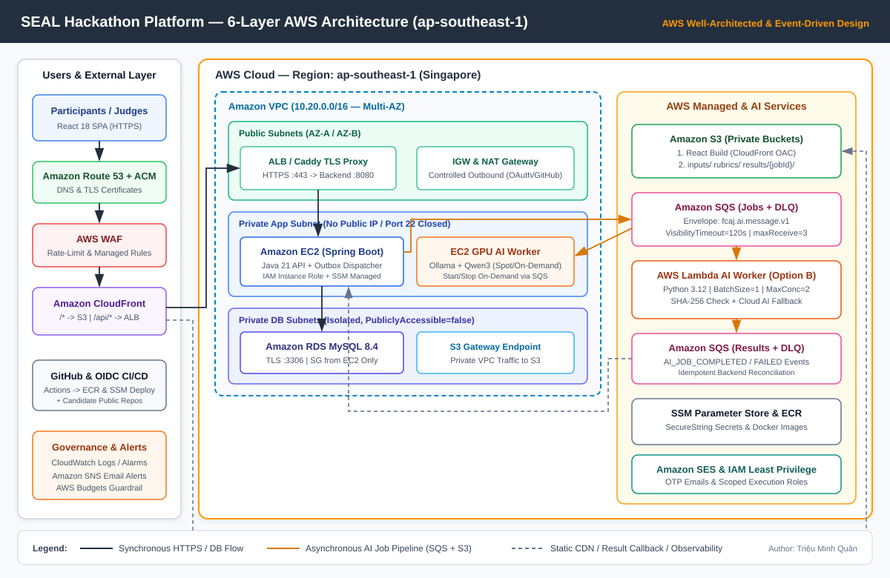

# SEAL Hackathon Platform — Nền tảng Quản lý & Chấm thi Hackathon trên AWS tích hợp Trợ lý Giám khảo AI Bất Đồng Bộ

---

## 1. Tổng quan bài toán & Tóm tắt điều hành (Executive Summary)

Các cuộc thi Hackathon quy mô đại học và cộng đồng công nghệ (như hệ thống **SEAL / FCAJ Hackathon System**) thường gặp tình trạng quá tải cho Hội đồng Giám khảo khi phải rà soát thủ công hàng chục đến hàng trăm repository GitHub trong thời gian ngắn. Việc kiểm tra kiến trúc phần mềm, phát hiện lỗ hổng bảo mật (lộ credentials/secret), đối chiếu unit test và chấm điểm theo bộ tiêu chí (Rubric) tốn nhiều giờ làm việc và dễ phát sinh sai lệch tiêu chuẩn giữa các giám khảo.

Đề xuất này xây dựng kiến trúc triển khai và hiện đại hóa **SEAL Hackathon Platform** lên hạ tầng **AWS (`ap-southeast-1` — Singapore)** theo mô hình **6 lớp (Edge, Network, Application & Data, Async AI Services, Observability & Governance, CI/CD)**. Điểm nhấn cốt lõi là phân hệ **Trợ lý Giám khảo AI Bất Đồng Bộ (AI Judge Worker)** sử dụng **Amazon S3**, **Amazon SQS (+ DLQ)**, **AWS EC2 GPU (Qwen3 Local LLM)** hoặc **AWS Lambda (Cloud AI Fallback)**, giúp đánh giá tự động mã nguồn tại commit SHA cố định, trích xuất dẫn chứng tới từng dòng code và trả kết quả tham khảo an toàn cho giám khảo trong vòng 15–30 giây/bài thi.

---

## 2. Vấn đề cần giải quyết, Mục tiêu & Phạm vi

### 2.1. Vấn đề hiện tại
1. **Chấm điểm thủ công chậm và thiếu đồng nhất:** Giám khảo mất nhiều thời gian clone từng repository, tìm file cấu hình, kiểm tra unit test và đối chiếu tiêu chí Rubric.
2. **Nghẽn cổ chai & Rủi ro rò rỉ mã nguồn nếu gọi AI đồng bộ:**
   - Gọi LLM đồng bộ trực tiếp trong request HTTP của API Backend (Spring Boot) sẽ làm treo kết nối (`504 Gateway Timeout`) do thời gian suy luận AI kéo dài từ 15–50 giây.
   - Đẩy thẳng mã nguồn chưa lọc lên các dịch vụ công cộng tiềm ẩn nguy cơ lộ thông tin nhạy cảm hoặc vi phạm bảo mật bài thi.
3. **Chi phí hạ tầng GPU cao nếu bật 24/7:** Một máy ảo AWS EC2 GPU (`g4dn.xlarge` hoặc `g5.xlarge`) có giá khoảng `$0.526 – $1.006/giờ`. Nếu bật liên tục 24/7 suốt tháng sẽ tốn `$380 – $720/tháng`, vượt xa ngân sách sinh viên/PoC (`<$20/tháng`).

### 2.2. Mục tiêu cụ thể
- **Tách rời hoàn toàn luồng web và luồng AI (Decoupling):** Backend trả về `HTTP 202 Accepted` ngay lập tức khi giám khảo yêu cầu chấm AI; tác vụ được đẩy qua **Amazon SQS** để xử lý bất đồng bộ.
- **Bảo mật mã nguồn & Tuân thủ chuẩn AWS:** Toàn bộ dữ liệu bài nộp (`inputs/`, `rubrics/`, `results/`) lưu trong **Amazon S3 Private Bucket**, phân quyền **IAM Least Privilege**, không hard-code secret.
- **Đầu ra AI có dẫn chứng (Evidence-based) & An toàn:** Bắt buộc tuân thủ JSON Schema (`fcaj.ai.output.v1`), tự động che secret (`***REDACTED***`), chống Prompt Injection và tính lại điểm trung bình trọng số bằng Python.
- **Kiểm soát ngân sách dưới 500.000 VNĐ/tháng (`~$20/tháng`) ở chế độ PoC/Demo.**

### 2.3. Phạm vi (Scope)
- **Trong phạm vi:** Hệ thống Web/API Hackathon (`React 18` + `Spring Boot 21` + `RDS MySQL 8.4`), đường ống **Asynchronous AI Judge** (`S3` + `SQS` + `DLQ` + `EC2 Ollama Qwen3` / `AWS Lambda`), giám sát **CloudWatch / SNS / AWS Budgets** và **CI/CD GitHub Actions OIDC -> ECR**.
- **Ngoài phạm vi:** AI chỉ đóng vai trò **Trợ lý Tham khảo (Technical Advisor)** cung cấp gợi ý và bằng chứng code; **Giám khảo con người vẫn giữ quyền quyết định điểm chính thức cuối cùng**. Không thực thi build/chạy code bất kỳ của thí sinh để tránh lỗ hổng RCE (Remote Code Execution).

---

## 3. Kiến trúc giải pháp sơ bộ & Lý do lựa chọn dịch vụ AWS

{}
💡 **Ghi chú sơ đồ:** Sơ đồ trên đã được dựng chuẩn 6 lớp theo thiết kế thực tế của dự án tại `ap-southeast-1`. Khi cần, bạn cũng có thể xuất thêm file `.png` từ file `.drawio` cá nhân của bạn thay vào đường dẫn `static/images/2-Proposal/seal-aws-architecture.svg` (hoặc `.png`) để khớp tuyệt đối với bài thuyết trình.
{}

### Căn cứ lựa chọn dịch vụ AWS (6 Lớp Kiến trúc)

| Lớp | Dịch vụ AWS | Vai trò trong giải pháp | Lý do lựa chọn |
| :--- | :--- | :--- | :--- |
| **1. Edge & Security** | **Route 53, AWS WAF, CloudFront, ACM** | Phân giải DNS, tường lửa chống crawler/spam login, CDN phân phối React SPA (`/*`) và định tuyến `/api/*` về ALB. | Giảm tải origin, bảo vệ endpoint đăng nhập bằng rate-limit WAF, dùng chung một domain giúp cookie `HttpOnly + SameSite=Lax` và CSRF hoạt động chuẩn. |
| **2. Network** | **Amazon VPC (2 AZ), IGW, NAT, ALB, S3 Gateway Endpoint** | Cô lập Backend/DB trong Private Subnet, chỉ mở HTTPS tại tầng edge; truy cập S3 nội bộ qua Gateway Endpoint. | Đáp ứng **Security Pillar**: đóng hoàn toàn cổng SSH (22), RDS đặt tại Private Subnet (`PubliclyAccessible=false`), giảm chi phí băng thông S3 qua Gateway Endpoint (`$0`). |
| **3. App & Data** | **EC2 (Spring Boot), RDS MySQL 8.4, Amazon S3** | Xử lý nghiệp vụ Hackathon, lưu trữ dữ liệu quan hệ có tính giao dịch (ACID) và lưu snapshot mã nguồn/kết quả AI. | RDS Managed lo backup/patching; S3 Private Bucket (OAC) tách riêng frontend build và dữ liệu bài thi với độ bền `99.999999999%`. |
| **4. Async AI Worker** | **Amazon SQS (+ 2 DLQs), EC2 GPU (Qwen3) / AWS Lambda (Python 3.12)** | Đệm hàng đợi `Jobs` và `Results`; thực thi phân tích mã nguồn bất đồng bộ; giữ message lỗi vào DLQ để kiểm tra. | **Cost & Reliability**: SQS giúp EC2 AI Worker không cần bật 24/7; khi không có đợt chấm có thể `Stop` EC2 mà không mất job; hoặc dùng Lambda Serverless cho chế độ Cloud AI API. |
| **5. Security & Governance** | **IAM, SSM Parameter Store, CloudWatch, SNS, AWS Budgets** | Phân quyền tối thiểu (Least Privilege), lưu secret `SecureString`, thu thập log/metric/alarm và cảnh báo ngân sách. | Loại bỏ 100% hard-code credentials; quản trị EC2 qua **Systems Manager Session Manager** không cần mở port 22. |
| **6. CI/CD** | **GitHub Actions OIDC, Amazon ECR** | Build container image, đẩy lên ECR theo commit SHA và triển khai qua SSM Run Command. | OIDC dùng token ngắn hạn thay thế hoàn toàn IAM Access Key dài hạn trên GitHub Secrets. |

---

## 4. Kế hoạch & Timeline thực hiện (12 Tuần)

| Giai đoạn | Thời gian | Nội dung trọng tâm | Kết quả bàn giao (Deliverables) |
| :--- | :---: | :--- | :--- |
| **Giai đoạn 1: Nền tảng Cloud** | Tuần 1 – 4 *(14/09 – 09/10/2026)* | Làm quen môi trường FCAJ; thực hành IAM, VPC, EC2, S3, RDS, CloudFront, SQS, Lambda & CloudWatch. | Tài khoản AWS sạch chuẩn bảo mật, AWS Budgets alert, hoàn thành các lab cốt lõi. |
| **Giai đoạn 2: Thiết kế & Contracts** | Tuần 5 – 6 *(12/10 – 23/10/2026)* | Phân tích bài toán SEAL Hackathon, thiết kế kiến trúc 6 lớp, chuẩn hóa `fcaj.ai.message.v1` & JSON Output Schema. | Proposal kiến trúc, bảng dự toán chi phí, bộ schema & sample input/output. |
| **Giai đoạn 3: Phát triển AI Worker & Benchmark** | Tuần 7 – 9 *(26/10 – 13/11/2026)* | Xây dựng `code_cleaner.py`, `ai_grader.py`, `sqs_worker.py`, `lambda_handler.py`; benchmark Qwen3 trên EC2 `ap-southeast-1`. | AI Worker pass 13/13 unit tests, báo cáo benchmark EC2 & tối ưu KV-Cache (`q8_0`). |
| **Giai đoạn 4: Tích hợp, Monitoring & Workshop** | Tuần 10 – 12 *(16/11 – 04/12/2026)* | Cấu hình CloudWatch Logs/Alarms, SNS Alerts, diễn tập E2E, viết Blog, hoàn thiện Workshop song ngữ & Clean-up. | Website Workshop song ngữ live trên GitHub Pages, Live Demo, Clean-up về `$0.00`. |

---

## 5. Bảng dự toán ngân sách & chi phí (Cost Estimation — AWS Pricing Calculator)

Dự toán tính cho vùng **`ap-southeast-1` (Singapore)** với kịch bản thực tế **1 đợt Hackathon/tháng (50 đội thi, 200 lượt chấm AI/tháng)**, tận dụng tối đa cơ chế tách hàng đợi **SQS On-Demand Start/Stop** cho EC2 AI Worker và AWS Free Tier:

### Phương án A: Kiến trúc Serverless / PoC Tiết Kiệm (Đề xuất cho Workshop & Demo)

| Dịch vụ AWS | Thông số cấu hình & Mức sử dụng/tháng | Chi phí ước tính/tháng | Ghi chú tối ưu |
| :--- | :--- | :---: | :--- |
| **Amazon S3** | `1 GB` lưu trữ (`inputs/`, `rubrics/`, `results/`, React SPA), `5,000 PUT/GET` | **$0.03** | Nằm trong AWS Free Tier (5 GB năm đầu) hoặc dùng S3 Lifecycle xóa snapshot tạm sau 30 ngày. |
| **Amazon SQS** | `4` hàng đợi (`Jobs`, `Jobs-DLQ`, `Results`, `Results-DLQ`), `< 10,000 requests` | **$0.00** | Miễn phí 1 triệu requests/tháng đầu tiên (Always Free Tier). |
| **AWS Lambda (Option B)** | `200 invocations/tháng`, `512 MB RAM`, trung bình `20s/job` (`2,000 GB-s`) | **$0.00** | Nằm gọn trong Free Tier 400,000 GB-seconds/tháng. |
| **EC2 AI Worker (`g4dn.xlarge` Spot — Option A)** | Bật theo đợt chấm: **`20 giờ/tháng`** (`~$0.18/giờ` Spot tại `ap-southeast-1`) + `30 GB gp3` EBS | **$6.00** | Tiết kiệm **98.4%** so với bật 24/7 (`$380/tháng`) nhờ SQS giữ job khi EC2 tắt. |
| **Amazon EC2 Backend (`t3.small` / `t4g.small`)** | `730 giờ/tháng` hoặc chạy giờ demo (`100 giờ/tháng`) | **$2.10 – $15.00** | Nếu dùng `t4g.small` Graviton hoặc Free Tier `t3.micro`/`m7i-flex.large` có thể giảm về `$0.00` năm đầu. |
| **Amazon RDS MySQL (`db.t4g.micro`)** | Single-AZ PoC (`20 GB gp3`), chạy giờ phát triển/demo | **$0.00 – $12.41** | Tận dụng AWS Free Tier `750 giờ/tháng` trong 12 tháng đầu (`$0.00`). |
| **CloudFront + Route 53 + WAF** | `5 GB` egress, 1 Hosted Zone, 1 Web ACL cơ bản (chỉ bật khi go-live) | **$0.50 – $6.50** | CloudFront Free Tier 1 TB/tháng; WAF chỉ gắn ở môi trường production chính thức. |
| **SSM Parameter Store & CloudWatch** | Standard Parameters (`0 USD`), Basic Logs `< 5 GB/tháng`, `2 Alarms` | **$0.20** | Giữ log retention 7–14 ngày để tránh tích lũy phí lưu trữ log. |
| **Cloud AI Fallback (DeepSeek API)** | `200 jobs × ~121k tokens/job` (`$0.0175 – $0.020/job` giờ thấp điểm) | **~$3.50 – $4.00** | Tận dụng **Context Caching** giảm tới 90% chi phí khi chấm lại cùng repo. |

> **Tổng kết ngân sách PoC / Workshop thực tế:**
> - **Chạy ở chế độ Workshop Lab / Free Tier (Option B Lambda + S3 + SQS + CloudWatch + EC2 Stop sau test):** **`~$0.50 – $4.20 / tháng`** (hoặc **`$0.00`** với Mock / Local Ollama test).
> - **Chạy cả cụm PoC đầy đủ có EC2 GPU Spot (`20 giờ/tháng`):** **`~$8.80 – $16.50 / tháng`** (nằm dưới mức trần `500.000 VNĐ/tháng`).

---

## 6. Rủi ro & Phương án giảm thiểu (Risks & Mitigation)

| Rủi ro | Mức độ ảnh hưởng | Phương án giảm thiểu đã thiết kế |
| :--- | :---: | :--- |
| **1. Quên tắt EC2 GPU hoặc vòng lặp retry SQS gây phát sinh hóa đơn cao** | **Cao** | Thiết lập **AWS Budgets** cảnh báo 50%/80%/100%; gắn script `shutdown -h +45` tự tắt máy trên EC2; cấu hình SQS `RedrivePolicy (maxReceiveCount = 3)` đẩy message lỗi sang DLQ và đặt `MaximumConcurrency = 2` trên Lambda. |
| **2. Repo thí sinh quá dài (>90k tokens) làm tràn VRAM / OOM trên EC2** | **Cao** | Bật `OLLAMA_KV_CACHE_TYPE=q8_0` & `OLLAMA_FLASH_ATTENTION=1` (giảm 50% VRAM context); triển khai **Smart Repo Slicing** (`code_cleaner.py`) lọc file rác/lockfile và ưu tiên thư mục `src/` mà vẫn giữ nguyên số thứ tự dòng gốc. |
| **3. Prompt Injection hoặc lộ Secret/Credentials trong nhận xét của AI** | **Cao** | Bọc source code trong thẻ `<CANDIDATE_SOURCE_CODE>` kèm chỉ thị cách ly; hậu kiểm bằng `redact_secrets()` (regex tự động che API key, password thành `***REDACTED***`) và `safeText` loại bỏ URL/email ngoài. |
| **4. LLM trả về sai cấu trúc JSON hoặc tính nhầm điểm trung bình trọng số** | **Trung bình** | Ép buộc Grammar-Constrained JSON Output (`format: json_schema` / `response_format`), hậu kiểm bằng Python (`compute_weighted_overall_score`) và kiểm tra `finish_reason != "length"` chống cắt cụt output. |
| **5. SQS phát lại tin nhắn trùng lặp (Duplicate Delivery) khi worker xử lý chậm** | **Trung bình** | Dùng luồng heartbeat gọi `sqs.change_message_visibility()` mỗi 45 giây; ghi file S3 với điều kiện **idempotent** `If-None-Match: "*"` và đối chiếu `analysisVersion` ở tầng Backend. |
