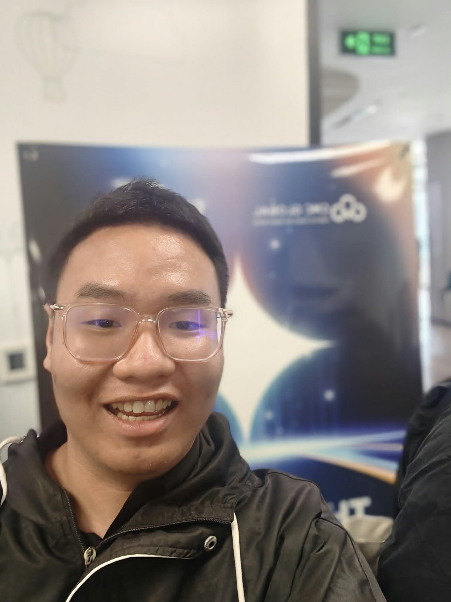

### Event Details

- **Event Name:** Kick-off FCAJ Buildathon 2026
- **Date & Time:** 09:00 – 11:20, September 26, 2026
- **Format:** In-person
- **Role:** Attendee

---

### Event Schedule

- **09:00 – 09:30 | Buildathon Kickoff:** Introduction to the Buildathon challenge, event objectives, judging criteria, and an overview of **AWS Cloud**, **Generative AI**, and building modern **AI Agents** on AWS.
- **09:30 – 09:45 | Ice-breaking:** Networking with fellow participants, sharing technical backgrounds in AWS and AI, and forming teams for the challenge.
- **09:45 – 10:30 | Talkshow — *Building a Career in Cloud & AI*:** Insights from industry professionals and AWS practitioners on cloud computing, AI trends, real-world projects, and career opportunities.
- **10:30 – 10:45 | Q&A Session:** Open discussion with speakers and mentors on AWS, Generative AI, career development, certifications, and Buildathon guidance.
- **10:45 – 11:15 | Hands-on — *AI Agent Challenge*:** Practical mini challenge building an AI-powered solution using **Prompt Engineering**, **Retrieval-Augmented Generation (RAG)**, **Knowledge Bases**, and **AI Agents** with mentor support.
- **11:15 – 11:20 | Closing Remarks:** Wrap-up of key takeaways, learning resources, and upcoming community activities.

---

### Main Content Covered

- **Buildathon Overview & AI Agents on AWS:** Understood the challenge scope, objectives, and judging criteria; learned how **AWS Cloud**, **Generative AI**, and **Agentic AI** are combined to build practical AI Agents beyond simple single-prompt demos.
- **Cloud & AI Career Insights (Talkshow & Q&A):** Gained practical perspectives from AWS practitioners on how organizations adopt AWS and Agentic AI to solve business problems, along with actionable advice on AWS certifications, foundational cloud skills, and hands-on portfolio building.
- **Hands-on Practice (*AI Agent Challenge*):** Built a working AI mini-solution on AWS with mentor guidance, applying **Prompt Engineering**, **RAG**, **Knowledge Bases**, and **AI Agents** to ground model outputs in relevant knowledge.

---

### Check-in Photo (Clear Face Proof)

---

### Key Takeaways & Personal Contribution

- **Architecture-First AI Mindset:** Building reliable AI solutions on AWS requires more than a capable model—it depends on well-structured **RAG / Knowledge Bases**, clear prompting, and proper cloud integration.
- **Collaboration & Mentorship:** Actively connected with teammates during **Ice-breaking** and engaged mentors during **Q&A** and **Hands-on** to sharpen technical problem-solving under time constraints.
- **Cloud & AI Skill Roadmap:** Built a clearer learning roadmap combining core AWS fundamentals with hands-on **Generative AI** and **AI Agents** practice for upcoming FCAJ community challenges.
