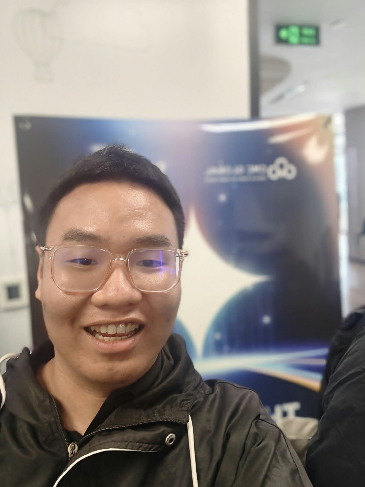

### Thông tin chung

- **Tên sự kiện:** Kick-off FCAJ Buildathon 2026
- **Thời gian:** 09:00 – 11:20, ngày 26/09/2026
- **Hình thức:** Tham dự trực tiếp (In-person)
- **Vai trò tham gia:** Người tham dự (Attendee)

---

### Lịch trình sự kiện

- **09:00 – 09:30 | Buildathon Kickoff:** Giới thiệu thử thách Buildathon, mục tiêu chương trình, tiêu chí đánh giá và tổng quan về **AWS Cloud**, **Generative AI** cùng cách xây dựng **AI Agents** hiện đại trên AWS.
- **09:30 – 09:45 | Ice-breaking:** Giao lưu, làm quen các thành viên tham dự, chia sẻ nền tảng kỹ thuật và kết nối lập đội.
- **09:45 – 10:30 | Talkshow — *Building a Career in Cloud & AI*:** Lắng nghe chia sẻ từ các chuyên gia và kỹ sư thực chiến về xu hướng Cloud, AI, dự án thực tế và cơ hội nghề nghiệp.
- **10:30 – 10:45 | Q&A Session:** Trao đổi trực tiếp với diễn giả và mentor về AWS, Generative AI, lộ trình phát triển nghề nghiệp, chứng chỉ và định hướng Buildathon.
- **10:45 – 11:15 | Hands-on — *AI Agent Challenge*:** Thực hành xây dựng giải pháp AI trên AWS với **Prompt Engineering**, **Retrieval-Augmented Generation (RAG)**, **Knowledge Bases** và **AI Agents**.
- **11:15 – 11:20 | Closing Remarks:** Tổng kết điểm nhấn sự kiện, tài nguyên học tập và các hoạt động cộng đồng tiếp theo.

---

### Nội dung chính tiếp thu

- **Tổng quan Buildathon & AI Agents trên AWS:** Nắm rõ bài toán, mục tiêu và tiêu chí chấm điểm của Buildathon; hiểu cách **AWS Cloud**, **Generative AI** và **Agentic AI** được ứng dụng để xây dựng AI Agent giải quyết vấn đề thực tế thay vì chỉ chạy demo bằng prompt đơn lẻ.
- **Định hướng nghề nghiệp Cloud & AI (Talkshow & Q&A):** Tiếp thu góc nhìn thực tế từ các chuyên gia về cách doanh nghiệp triển khai AWS và Agentic AI, tầm quan trọng của kiến thức nền tảng Cloud, giá trị của chứng chỉ AWS gắn với dự án thực hành (hands-on projects) và lộ trình chuẩn bị cho sự nghiệp Cloud & AI.
- **Thực hành Hands-on (*AI Agent Challenge*):** Trực tiếp thực hành dựng giải pháp AI mini trên AWS dưới sự hỗ trợ của mentor, hiểu rõ cách phối hợp **Prompt Engineering**, **RAG**, **Knowledge Bases** và **AI Agents** để nâng cao độ chính xác và tính thực tiễn cho mô hình.

---

### Hình ảnh check-in rõ mặt chứng minh tham gia

---

### Bài học rút ra & Đóng góp cá nhân

- **Tư duy kiến trúc gắn với thực tiễn:** Một hệ thống AI hiệu quả trên Cloud không chỉ phụ thuộc vào mô hình mà cần thiết kế bài bản từ dữ liệu (**RAG / Knowledge Bases**), prompt cho đến cách tích hợp các dịch vụ AWS.
- **Kỹ năng cộng tác & phản biện kỹ thuật:** Chủ động giao lưu qua phần **Ice-breaking**, kết nối với đồng đội và đặt câu hỏi trực tiếp cho mentor trong phiên **Q&A** và **Hands-on** để tháo gỡ nhanh các vướng mắc về kiến trúc.
- **Định hướng phát triển kỹ năng Cloud & AI:** Củng cố lộ trình tự học nền tảng AWS kết hợp thực hành các bài lab **Generative AI** và **AI Agents**, sẵn sàng cho các thử thách kỹ thuật trong cộng đồng FCAJ.
