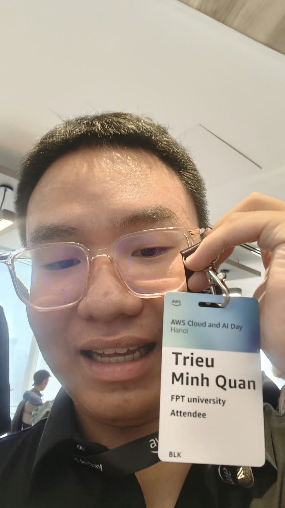

### Thông tin chung

- **Tên sự kiện:** AWS Cloud & AI Day Hanoi 2026
- **Thời gian:** Ngày 29/09/2026
- **Địa điểm:** Hà Nội (Tham dự trực tiếp — In-person)
- **Vai trò tham gia:** Người tham dự (Attendee)

---

### Nội dung phiên chia sẻ đã tham dự (Agenda)

Phiên chuyên đề về xây dựng hệ thống tri thức doanh nghiệp (**Enterprise Knowledge Hub**) trên AWS gồm 6 phần chính:

1. **The Enterprise Knowledge Challenge:** Nhận diện bài toán dữ liệu tri thức phân tán trong doanh nghiệp (tài liệu nằm rải rác ở nhiều nguồn, khó tìm kiếm chính xác, dễ lỗi thời khi quy mô nhân sự và dữ liệu tăng nhanh).
2. **Building an Enterprise Knowledge Hub:** Cách kiến trúc một trung tâm tri thức tập trung trên nền tảng **AWS Cloud**, chuẩn hóa luồng thu thập, lập chỉ mục (indexing) và đồng bộ dữ liệu phục vụ cho ứng dụng AI.
3. **Retrieval and Intelligence:** Kết hợp kỹ thuật truy xuất thông tin (**Retrieval / RAG**) với các mô hình AI để trích xuất câu trả lời đúng ngữ cảnh, giảm sai lệch (hallucination) và nâng cao tốc độ tra cứu tri thức nội bộ.
4. **Security and Governance:** Các nguyên tắc bảo mật và quản trị dữ liệu khi triển khai AI trong doanh nghiệp — kiểm soát quyền truy cập theo vai trò (access control), bảo vệ dữ liệu nhạy cảm và đảm bảo tuân thủ (governance).
5. **Delivery and Proven Results:** Cách đo lường hiệu quả triển khai thực tế (tốc độ tìm kiếm thông tin, độ chính xác câu trả lời, mức độ cải thiện năng suất vận hành).
6. **Roadmap to Enterprise Adoption:** Lộ trình đưa giải pháp từ giai đoạn thử nghiệm (PoC) sang vận hành ở quy mô doanh nghiệp, mở rộng theo từng nhóm người dùng và quản trị thay đổi.

---

### Hình ảnh tham dự sự kiện

---

### Bài học rút ra & Đóng góp cá nhân

- **Không tách rời AI khỏi bài toán quản trị dữ liệu:** Để AI trả lời chính xác cho doanh nghiệp, khâu tổ chức **Enterprise Knowledge Hub** và cơ chế **Retrieval** quan trọng không kém việc lựa chọn mô hình ngôn ngữ.
- **Bảo mật & phân quyền là điều kiện tiên quyết (Security & Governance):** Khi đưa dữ liệu nội bộ vào hệ thống tìm kiếm/RAG, cần đảm bảo người dùng chỉ truy xuất được tài liệu đúng phạm vi quyền hạn của mình.
- **Tư duy triển khai theo lộ trình (PoC → Enterprise Adoption):** Áp dụng cách tiếp cận từng bước, đo lường kết quả rõ ràng trước khi mở rộng quy mô — phù hợp để vận dụng vào các hệ thống AI và pipeline thực hành trong kỳ thực tập OJT.
