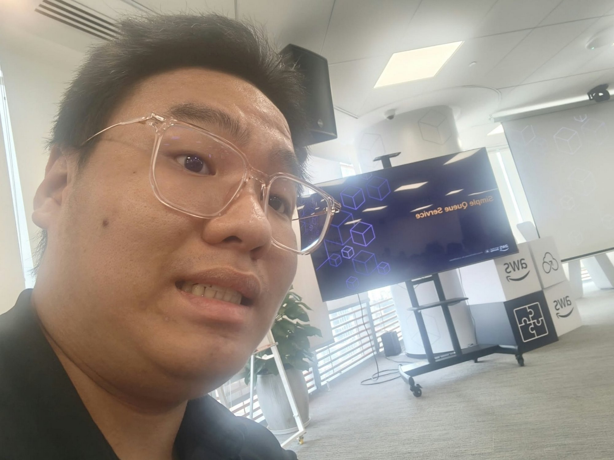

### Event Details

- **Event Name:** AWS First Cloud AI Journey Community Day 2026
- **Date & Time:** 09:00 – 12:00, October 31, 2026
- **Format:** In-person
- **Role:** Attendee

---

### Event Schedule

- **09:00 – 09:25 AM | Lessons Learned from Building Software Factories:** Real-world lessons from building software factories at scale, common pitfalls to avoid, and what works in practice.
- **09:30 – 09:55 AM | Education:** An educator's perspective on preparing next-generation cloud talent and bridging the gap between universities and businesses.
- **10:00 – 10:25 AM | AWS Lambda Web Functions: Rethinking Serverless Web Architecture:** How native HTTP support and **128-request multi-concurrency** redefine Serverless compute, eliminating adapter overhead, leveraging **Active CPU Billing**, and comparing Serverless against Docker on EC2/ECS with live performance benchmarks.
- **10:30 – 11:00 AM | Amazon SQS: Building Asynchronous Systems:** Why modern systems need asynchronous processing, using **Amazon SQS** to decouple and scale architectures, and practical design patterns.
- **11:00 – 11:25 AM | My 3-Month AWS Internship Journey:** Sharing a 3-month AWS internship experience, applying AWS services to real projects, and practical advice for incoming interns.
- **11:30 – 12:00 PM | Start & Maintain Consistency with Open Source Contributing:** Making a first open-source contribution from scratch, maintaining a consistent habit, and its impact on career growth.

---

### Main Content Covered

- **Modern Serverless & Asynchronous Architecture:**
  - Learned how **AWS Lambda Web Functions** remove adapter overhead with native HTTP support and **128-request multi-concurrency**, while **Active CPU Billing** optimizes cost compared to Docker on EC2/ECS.
  - Reinforced asynchronous system design principles using **Amazon SQS** to decouple components, absorb traffic spikes, and scale reliably.
- **Engineering Scale & Internship Insights:**
  - Gained practical lessons from building **Software Factories** at scale and avoiding common operational pitfalls.
  - Learned from both educators and past AWS interns on bridging academic foundations with real-world AWS project delivery during a 3-month internship.
- **Open Source Consistency:** Understood how to start contributing to open-source projects from scratch and build a sustainable habit for continuous technical growth.

---

### Check-in Photo (Clear Face Proof)

---

### Key Takeaways & Personal Contribution

- **Asynchronous Architecture Mindset:** Insights from *Amazon SQS: Building Asynchronous Systems* clarified how message queues decouple heavy workloads to improve resilience and scalability in modern cloud systems.
- **Pragmatic Compute Trade-offs:** Live benchmarks comparing **AWS Lambda Web Functions** (**Active CPU Billing**) with Docker on EC2/ECS highlighted how to choose compute options based on actual workload characteristics.
- **Consistency & Community Contribution:** Applying the steady-habit mindset from *Open Source Contributing* to maintain consistent self-study, technical knowledge sharing, and active participation in the AWS community.
