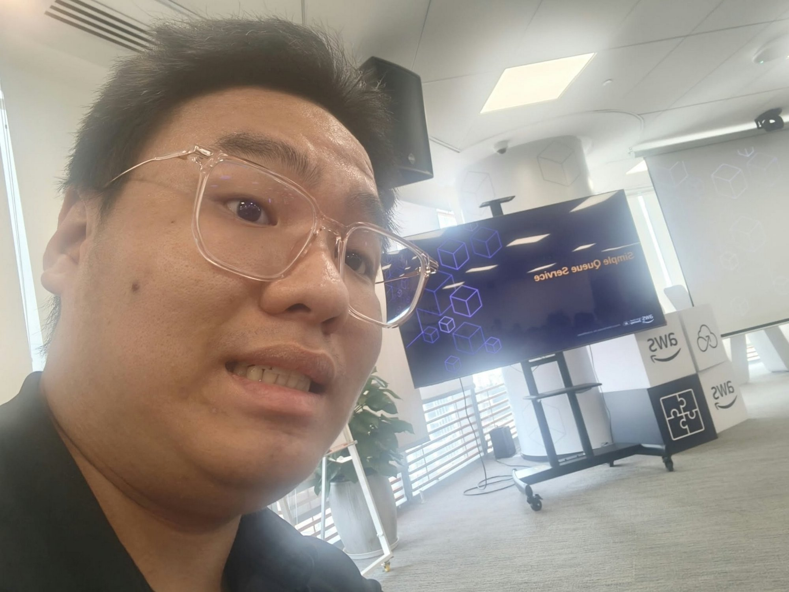

### Thông tin chung

- **Tên sự kiện:** AWS First Cloud AI Journey Community Day 2026
- **Thời gian:** 09:00 – 12:00, ngày 31/10/2026
- **Hình thức:** Tham dự trực tiếp (In-person)
- **Vai trò tham gia:** Người tham dự (Attendee)

---

### Lịch trình sự kiện

- **09:00 – 09:25 | Lessons Learned from Building Software Factories:** Chia sẻ kinh nghiệm thực tế xây dựng "software factories" ở quy mô lớn, các bẫy thường gặp và giải pháp hiệu quả trong thực tiễn.
- **09:30 – 09:55 | Education:** Góc nhìn từ giảng viên/người đào tạo về chuẩn bị thế hệ nhân lực Cloud tiếp theo, hành trang sinh viên cần có và cách thu hẹp khoảng cách giữa đại học với doanh nghiệp.
- **10:00 – 10:25 | AWS Lambda Web Functions: Rethinking Serverless Web Architecture:** Cách hỗ trợ HTTP gốc (native HTTP support) và **128-request multi-concurrency** định hình lại Serverless compute; loại bỏ adapter overhead, tận dụng **Active CPU Billing** để tối ưu chi phí và so sánh thực tế giữa Serverless với Docker trên EC2/ECS qua benchmark trực tiếp.
- **10:30 – 11:00 | Amazon SQS: Building Asynchronous Systems:** Lý do hệ thống hiện đại cần xử lý bất đồng bộ, cách dùng **Amazon SQS** để tách rời (decouple) và mở rộng kiến trúc, cùng các design pattern và mẹo triển khai thực tế.
- **11:00 – 11:25 | My 3-Month AWS Internship Journey:** Chia sẻ hành trình 3 tháng thực tập AWS, cách áp dụng dịch vụ AWS vào dự án thật và lời khuyên cho các bạn sắp bắt đầu kỳ thực tập.
- **11:30 – 12:00 | Start & Maintain Consistency with Open Source Contributing:** Cách bắt đầu đóng góp Open Source từ con số 0, duy trì thói quen đều đặn và tác động tích cực tới kỹ năng lẫn sự nghiệp.

---

### Nội dung chính tiếp thu

- **Kiến trúc Serverless & Xử lý bất đồng bộ hiện đại:**
  - Nắm được cách **AWS Lambda Web Functions** giải quyết bài toán chạy web framework trên Serverless mà không cần adapter cồng kềnh, tận dụng **128-request multi-concurrency** và **Active CPU Billing** để cân bằng hiệu năng – chi phí so với Docker trên EC2/ECS.
  - Củng cố tư duy thiết kế **Asynchronous Systems** với **Amazon SQS** để tách rời (decouple) các thành phần tải nặng, giảm nghẽn cổ chai và tăng khả năng chịu tải cho hệ thống phân tán.
- **Kinh nghiệm kỹ thuật ở quy mô lớn & Thực tập AWS:**
  - Tiếp thu bài học thực tế khi vận hành **Software Factories** (những lỗi quy trình cần tránh để giữ chất lượng đồng đều).
  - Tham khảo góc nhìn từ cả giảng viên lẫn thực tập sinh đi trước về cách biến kiến thức nền trên trường thành sản phẩm chạy thật trên AWS trong 3 tháng OJT.
- **Xây dựng thói quen Open Source:** Hiểu quy trình bắt đầu đóng góp mã nguồn mở từ những bước nhỏ và cách duy trì sự ổn định lâu dài để phát triển kỹ năng kỹ thuật.

---

### Hình ảnh check-in rõ mặt chứng minh tham gia

---

### Bài học rút ra & Đóng góp cá nhân

- **Hiểu rõ vai trò của kiến trúc bất đồng bộ:** Kiến thức từ phiên *Amazon SQS: Building Asynchronous Systems* giúp nắm vững cách tách rời (decouple) các tác vụ xử lý nặng bằng hàng đợi để tăng độ ổn định và khả năng mở rộng cho hệ thống.
- **Cân nhắc đúng bài toán chi phí & compute:** So sánh thực tế giữa Serverless (**AWS Lambda Web Functions** / **Active CPU Billing**) và container trên EC2/ECS giúp biết cách chọn kiến trúc theo đặc thù workload thay vì chạy theo xu hướng.
- **Kỷ luật học tập & đóng góp cộng đồng:** Áp dụng tinh thần duy trì thói quen đều đặn từ phiên *Open Source Contributing* vào việc tự học hằng tuần, chia sẻ bài viết kỹ thuật và tham gia tích cực các hoạt động cộng đồng AWS.
