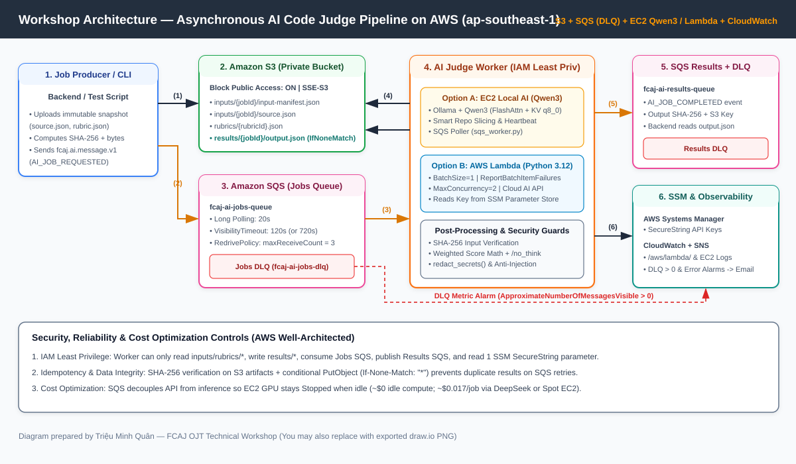

### 1. Detailed Architecture Diagram



{}
💡 **Note:** You may also export your personal `.drawio` diagram to PNG inside `static/images/5-Workshop/` to complement or customize this diagram.
{}

---

### 2. End-to-End Data Flow (6 Steps)

1. **Step 1 — Package & Upload Immutable Artifacts to Amazon S3:**
   - The producer scans the target repo via `code_cleaner.py` (excluding `node_modules`, `target`, binaries, lockfiles while preserving line numbers).
   - Uploads three immutable JSON objects to a **Private S3 Bucket**:
     - `poc/inputs/{jobId}/input-manifest.json` (SHA-256 checksums + byte sizes)
     - `poc/inputs/{jobId}/source.json`
     - `poc/rubrics/{rubricId}.json`
2. **Step 2 — Dispatch Lightweight Envelope to Amazon SQS (`fcaj-ai-jobs-queue`):**
   - Following the **Claim-Check Pattern**, SQS carries only the compact `fcaj.ai.message.v1` envelope (`< 32 KB`) referencing S3 keys and SHA-256 digests.
3. **Step 3 — Consume Jobs from SQS:**
   - **Option A (EC2 Local AI):** `sqs_worker.py` executes SQS long polling (`WaitTimeSeconds=20`) alongside a background heartbeat extending `VisibilityTimeout` every 45s.
   - **Option B (AWS Lambda):** Python 3.12 Lambda consumes SQS triggers with `BatchSize=1`, `ReportBatchItemFailures`, and `MaximumConcurrency=2`.
4. **Step 4 — Integrity Verification & AI Evaluation:**
   - The worker downloads artifacts from S3 and verifies **SHA-256** and `sizeBytes`. Mismatches raise `ContractValidationError` (routing to DLQ after 3 attempts).
   - **Option A** invokes local Ollama (`http://127.0.0.1:11434/v1/chat/completions`) running `qwen3` (`/no_think`, `q8_0` KV-cache). **Option B** fetches the API key from **SSM Parameter Store** (`SecureString`) and calls DeepSeek API.
   - Python post-processing deterministically recalculates `overall_score` (`compute_weighted_overall_score`), removes accidental line prefixes (`strip_line_number_prefix`), redacts secrets (`redact_secrets`), and sanitizes `safeText`.
5. **Step 5 — Idempotent S3 Result Write & SQS Completion Event:**
   - Writes `fcaj.ai.output.v1` to `poc/results/{jobId}/output.json` with conditional header **`If-None-Match: "*"`** to block duplicate overwrites.
   - Emits `AI_JOB_COMPLETED` with the output SHA-256 to **`fcaj-ai-results-queue`**, then deletes the source message from `fcaj-ai-jobs-queue`.
6. **Step 6 — Observability & Alerting (CloudWatch + SNS):**
   - Worker logs stream to **CloudWatch Logs**.
   - Any poison message reaching the DLQ (`maxReceiveCount = 3`) fires a **CloudWatch Alarm** (`ApproximateNumberOfMessagesVisible > 0`) that notifies administrators via **Amazon SNS** email.

---

### 3. Message Envelope (`fcaj.ai.message.v1`)

```json
{
  "schemaVersion": "fcaj.ai.message.v1",
  "messageType": "AI_JOB_REQUESTED",
  "jobId": "c7a8e801-b27b-40b5-9d36-fa28dbfa9801",
  "submissionId": 101,
  "inputRevision": 1,
  "commitSha": "b980a2cc3eaae318a3c50eba968b0c72e1dd08ab",
  "artifacts": {
    "manifestKey": "poc/inputs/c7a8e801/input-manifest.json",
    "manifestSha256": "<sha256-hex-64>",
    "sourceKey": "poc/inputs/c7a8e801/source.json",
    "rubricKey": "poc/rubrics/rubric-v1.json"
  }
}
```
