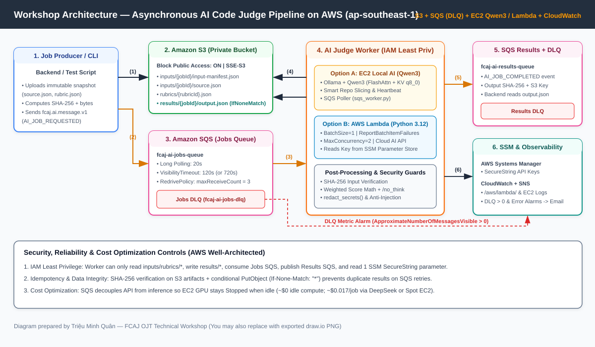

### 1. Sơ đồ Kiến trúc Chi tiết (Architecture Diagram)



{}
💡 **Ghi chú:** Bạn có thể xuất file sơ đồ `.drawio` cá nhân thành ảnh PNG thay vào đường dẫn `static/images/5-Workshop/` nếu muốn bổ sung chi tiết từ bản vẽ riêng của mình.
{}

---

### 2. Luồng Dữ liệu Đầu cuối (End-to-End Data Flow — 6 Bước)

1. **Bước 1 — Đóng gói & Upload Artifact lên Amazon S3:**
   - Producer (Backend hoặc CLI test) quét mã nguồn dự án qua `code_cleaner.py` (loại bỏ `node_modules`, `target`, file nhị phân, giữ nguyên số thứ tự dòng).
   - Tạo 3 file JSON bất biến đưa lên **Amazon S3 Private Bucket**:
     - `poc/inputs/{jobId}/input-manifest.json` (chứa checksum SHA-256 và `sizeBytes`)
     - `poc/inputs/{jobId}/source.json`
     - `poc/rubrics/{rubricId}.json`
2. **Bước 2 — Đẩy thông điệp nhẹ vào Amazon SQS (`fcaj-ai-jobs-queue`):**
   - Áp dụng **Claim-Check Pattern**: SQS chỉ nhận envelope `fcaj.ai.message.v1` (`< 32 KB`) chứa `jobId`, `submissionId`, các key S3 và SHA-256 tương ứng.
3. **Bước 3 — Worker tiêu thụ Job từ SQS:**
   - **Option A (EC2 Local AI):** `sqs_worker.py` chạy long-polling (`WaitTimeSeconds=20`) và luồng heartbeat gia hạn `VisibilityTimeout` mỗi 45 giây.
   - **Option B (AWS Lambda):** AWS Lambda Python 3.12 nhận event từ SQS với `BatchSize=1`, `ReportBatchItemFailures` và `MaximumConcurrency=2`.
4. **Bước 4 — Xác thực toàn vẹn & Suy luận AI:**
   - Worker tải artifact từ S3, kiểm tra khớp 100% **SHA-256** và `sizeBytes`. Nếu sai lệch -> ném `ContractValidationError` (chuyển sang DLQ sau 3 lần thử).
   - Nếu là **Option A**, gọi Ollama (`http://127.0.0.1:11434/v1/chat/completions`) với model `qwen3` (`/no_think`, `KV Cache q8_0`). Nếu là **Option B**, đọc API key từ **SSM Parameter Store** (`SecureString`) và gọi DeepSeek API.
   - Hậu kiểm chặt bằng Python: tính lại `overall_score` theo trọng số rubric (`compute_weighted_overall_score`), loại tiền tố số dòng (`strip_line_number_prefix`), che mật khẩu/API key (`redact_secrets`) và làm sạch `safeText`.
5. **Bước 5 — Ghi kết quả Idempotent lên S3 & Báo cáo qua SQS Results:**
   - Ghi JSON kết quả `fcaj.ai.output.v1` lên `poc/results/{jobId}/output.json` với header **`If-None-Match: "*"`** chống ghi đè trùng lặp.
   - Gửi thông điệp `AI_JOB_COMPLETED` kèm SHA-256 của output vào **`fcaj-ai-results-queue`**. Chỉ sau khi gửi thành công mới xóa message khỏi `fcaj-ai-jobs-queue`.
6. **Bước 6 — Giám sát & Cảnh báo (CloudWatch + SNS):**
   - Toàn bộ nhật ký chạy được đẩy về **CloudWatch Logs**.
   - Nếu bất kỳ job nào gặp lỗi quá 3 lần (`maxReceiveCount = 3`) và rơi vào **DLQ**, **CloudWatch Alarm** (`ApproximateNumberOfMessagesVisible > 0`) lập tức kích hoạt **Amazon SNS** gửi email cho quản trị viên.

---

### 3. Hợp đồng Dữ liệu (Data Contract `fcaj.ai.message.v1` & `fcaj.ai.output.v1`)

```json
{
  "schemaVersion": "fcaj.ai.message.v1",
  "messageType": "AI_JOB_REQUESTED",
  "jobId": "c7a8e801-b27b-40b5-9d36-fa28dbfa9801",
  "submissionId": 101,
  "inputRevision": 1,
  "commitSha": "b980a2cc3eaae318a3c50eba968b0c72e1dd08ab",
  "artifacts": {
    "manifestKey": "poc/inputs/c7a8e801/input-manifest.json",
    "manifestSha256": "<sha256-hex-64>",
    "sourceKey": "poc/inputs/c7a8e801/source.json",
    "rubricKey": "poc/rubrics/rubric-v1.json"
  }
}
```
